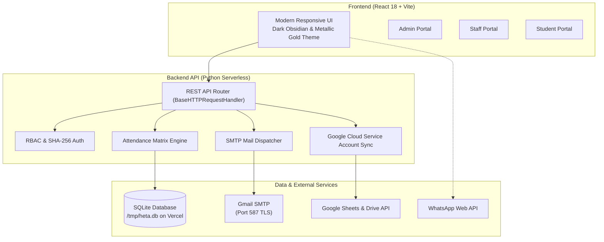

# 🏆 HETA-HRM: Attendance & Human Resource Management System

[](https://vercel.com)
[](https://python.org)
[](https://react.dev)
[](https://vitejs.dev)
[](LICENSE)

An enterprise-ready, dynamic **Attendance, Leave Management, and Human Resource System** designed for **HETA Higher Education & Training Academy**. Features multi-portal Role-Based Access Control (RBAC), real-time attendance matrix registers, automated dual-email leave notifications, WhatsApp/Email absent alerts, and bi-directional Google Sheets synchronization.

---

## 🌟 Key Capabilities

### 1. 📋 Strict 3-State Attendance Register
- **Strict Canonical States**: Exactly three states enforced system-wide: **`PRESENT`**, **`ABSENT`**, and **`HOLIDAY`**.
- **Interactive Daily Roll Call**:
  - Filter by dynamic course, batch, and role (Student vs. Staff).
  - Bulk actions: "Mark All Present" or "Mark Entire Day as Holiday".
  - Time logging (In-Time & Out-Time) and session notes.
- **Monthly Matrix Register**:
  - Full 31-day calendar view with weekday indicators and color-coded status badges.
  - Real-time KPI calculations: Working Days, Present Count, Absent Count, and Overall Attendance Rate %.

### 2. 🔐 Multi-Portal Role-Based Access Control (RBAC)
- **Super Administrator Portal**: Complete control over attendance, member directory, leave approvals, absent parent alerts, and cloud sync.
- **Staff Portal**: Dedicated dashboard for faculty to conduct batch roll calls, view batch statistics, and inspect monthly matrices.
- **Student Portal**: Personalized portal for enrolled students to view their attendance calendar, attendance rate %, and apply for leaves.
- **Security**: Salted SHA-256 password hashing and token-based session verification.

### 3. 📧 Automated Leave Management & Dual Email Dispatch
- **Leave Application Workflow**: Students submit Casual, Sick, Academic, or Emergency leave requests with date ranges and justification.
- **Dual Email Notification**: Upon submission, the server automatically dispatches simultaneous notification emails via SMTP to:
  1. `hetahighereducation@gmail.com`
  2. `balajimanokaranmd@gmail.com`
- **One-Click Approval**: Administrators can approve or reject requests with review remarks. Approved leaves automatically reflect across the attendance matrix.

### 4. 📢 Absent Student Alerts (WhatsApp & Direct Email)
- **Instant Intimation**: When a student is marked absent, a single click opens the notification dispatch modal.
- **WhatsApp Web Integration**: Pre-populates a polite, customizable intimation message formatted directly for WhatsApp Web with international phone number formatting.
- **Direct SMTP Email**: Sends official absence alerts directly to student and parent email addresses from the server.

### 5. 📗 Google Sheets Bi-Directional Master Synchronizer
- Authenticates securely via **Google Cloud Service Account** (`heta-attandace-report@united-watch-513401-b4.iam.gserviceaccount.com`).
- One-click synchronization updates 4 structured worksheets in your master spreadsheet:
  1. **Daily Attendance**: Complete attendance logs with timestamps and session notes.
  2. **Members Directory**: Student and staff master database with contact information.
  3. **Leave Applications**: Complete leave audit trail and approval status.
  4. **Attendance KPI Summary**: Live computed analytics and <75% attendance warnings.
- Automatically shares the spreadsheet with administrator email addresses.

### 6. 🖨 Professional Exports & Reports
- **Landscape A4 PDF Reports**: Clean, printable register with official academy header, date ranges, and signature lines.
- **CSV Data Exports**: One-click download of attendance logs and leave registers.

---

## 🏗 Architecture & Tech Stack



---

## 🚀 Quick Start (Local Development)

### Prerequisites
- **Python 3.9+**
- **Node.js 18+** & npm

### 1. Clone Repository & Install Dependencies
```bash
git clone https://github.com/praveshbalaji/heta-hrm-portal.git
cd heta-hrm-portal

# Install frontend dependencies
cd frontend
npm install
cd ..

# Install backend dependencies
pip install -r backend/requirements.txt
```

### 2. Environment Configuration
Copy the sample environment file:
```bash
cp .env.example .env
```
Update SMTP credentials in `.env` if you wish to enable live email delivery.

### 3. Run the Servers
Open two terminal windows:

**Terminal 1 (Python Backend API)**:
```bash
cd backend
python server.py
# Server listening on http://localhost:5050
```

**Terminal 2 (React Frontend Dev Server)**:
```bash
cd frontend
npm run dev
# Vite dev server running at http://localhost:3001
```

Or on Windows, simply double-click **`run_heta_hrm.bat`** to launch both automatically!

---

## ☁️ Vercel Deployment

For full deployment instructions, see the dedicated [VERCEL_SETUP.md](VERCEL_SETUP.md).

### 1-Click Deployment Summary
1. Push this repository to GitHub.
2. In Vercel, click **Add New Project** and select this repository.
3. Vercel automatically detects `vercel.json` and configures the build:
   - **Build Command**: `cd frontend && npm install && npm run build`
   - **Output Directory**: `frontend/dist`
   - **Serverless API**: `api/index.py` handles all `/api/*` routes
4. Add your **Environment Variables** in the Vercel Dashboard:
   - `HETA_SMTP_USER`: `hetahighereducation@gmail.com`
   - `HETA_SMTP_PASS`: Your 16-character Google App Password
   - `HETA_ADMIN_EMAILS`: `hetahighereducation@gmail.com,balajimanokaranmd@gmail.com`
   - `GOOGLE_SERVICE_ACCOUNT_JSON`: Full JSON content of your Google Cloud Service Account key
5. Click **Deploy**!

---

## 🔐 Default Access Accounts

All accounts come pre-configured with secure salted passwords:

| Role | Email | Password | Permissions |
| :--- | :--- | :--- | :--- |
| **Super Administrator** | `hetahighereducation@gmail.com` | `Heta@123` | Full administrative control, member CRUD, leave approvals, alerts, sheets sync |
| **Academic Admin** | `admin@heta.edu` | `Admin@123` | Roster management, attendance entry |
| **Staff Member** | `staff@heta.edu` | `Staff@123` | Daily attendance marking, batch roll call, attendance matrix |
| **Student Member** | `student@heta.edu` | `Student@123` | Attendance history, calendar view, leave applications |

---

## ⚙️ Environment Variables Reference

| Variable | Default Value | Description |
| :--- | :--- | :--- |
| `HETA_SMTP_HOST` | `smtp.gmail.com` | Outgoing SMTP server address |
| `HETA_SMTP_PORT` | `587` | Port for TLS encryption |
| `HETA_SMTP_USER` | `hetahighereducation@gmail.com` | SMTP authentication username |
| `HETA_SMTP_PASS` | `Heta@123` | SMTP password (use 16-character Google App Password) |
| `HETA_SMTP_SENDER` | `hetahighereducation@gmail.com` | Display "From" email address |
| `HETA_ADMIN_EMAILS` | `hetahighereducation@gmail.com,balajimanokaranmd@gmail.com` | Comma-separated admin notification recipients |
| `GOOGLE_SERVICE_ACCOUNT_JSON` | `None` | Stringified JSON credentials for Google Cloud Service Account |
| `VITE_API_BASE` | Auto-detected | Relative `/api` on Vercel, `http://localhost:5050/api` on local dev |

---

## 📄 License

This project is licensed under the MIT License - see the [LICENSE](LICENSE) file for details.

Developed with precision for **HETA Higher Education & Training Academy**.
